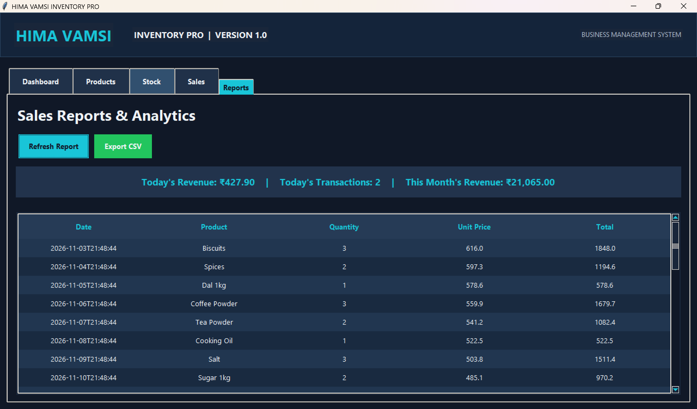
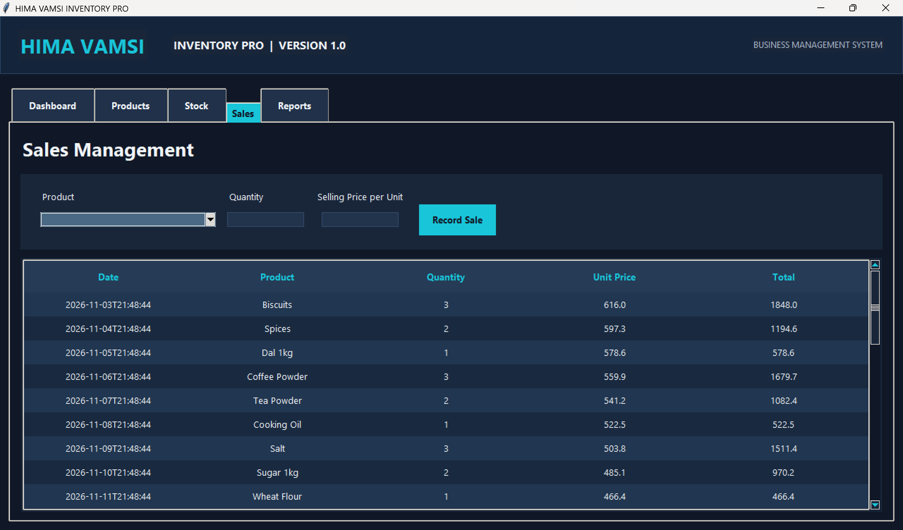
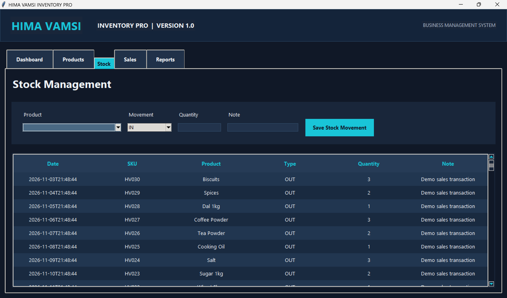
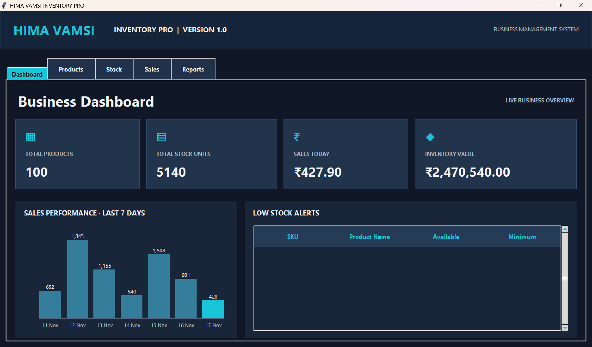

# Hima Vamsi Inventory Pro

### Professional Inventory Management System

A desktop-based Inventory Management System developed using **Python, Tkinter, and SQLite**.

## Overview

Hima Vamsi Inventory Pro is designed to simplify business inventory operations through a modern graphical user interface. It helps manage products, stock movements, sales, and business reports in one application.

## Key Features

- **Dashboard:** Business overview with summary cards and sales performance chart.
- **Product Management:** Manage product information and inventory records.
- **Stock Management:** Track stock movements and available quantities.
- **Sales Management:** Manage sales transactions.
- **Low Stock Alerts:** Identify products that need restocking.
- **Reports:** View inventory and business reports.
- **CSV Export:** Export report data into CSV files.
- **Database:** Store application data using SQLite.
- **Modern UI:** Professional dark-themed interface with improved navigation.

## Technologies Used

| Technology | Purpose |
|---|---|
| Python | Application development |
| Tkinter | Graphical User Interface |
| SQLite | Database management |
| CSV | Report export |
| ttk | UI components |

## Project Structure

```text
Hima-Vamsi-Inventory-Pro/
│
├── inventory_pro.py
├── inventory_pro_backup.py
├── README.md
└── .gitignore
```

## How to Run

1. Install Python 3.
2. Download or clone this repository.
3. Open the project folder in VS Code.
4. Run the following command:

```bash
python inventory_pro.py
```

## Application Preview

## Application Screenshots

### Dashboard


### Products


### Stock


### Reports


The application includes a business dashboard, product management, stock operations, sales management, and reporting features.

## Developer

**Hima Vamsi**

Python Developer | Aspiring Data Analyst

---

⭐ If you find this project useful, consider giving it a Star on GitHub.

**Project:** Hima Vamsi Inventory Pro  
**Version:** 1.0  
**Status:** Development Project
